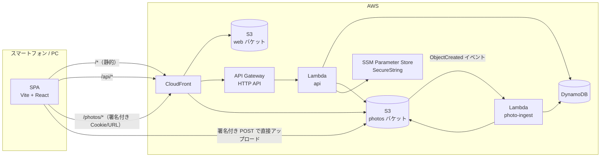
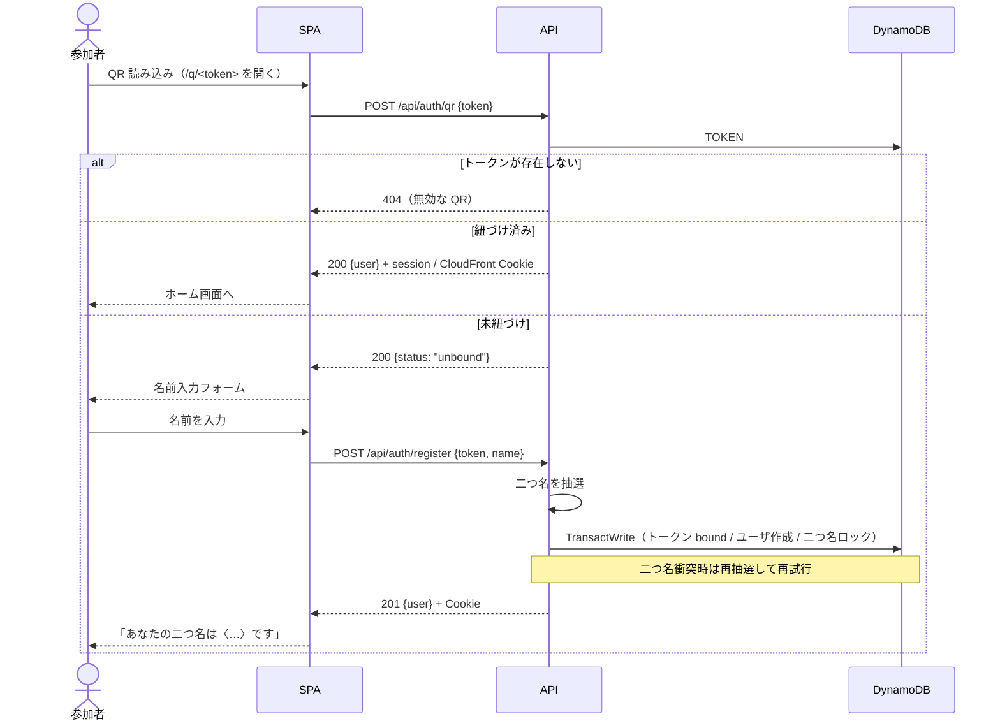
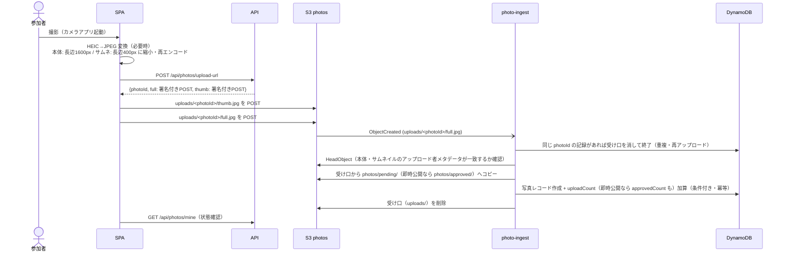

# partally 設計書

忘年会などの余興イベントで、参加者の管理・写真共有・ポイント集計を行う社内向け Web システム。

- 想定規模: 参加者 80 名程度 / 1 イベント
- 利用端末: 参加者はスマートフォン（ブラウザ）、管理者は PC またはスマートフォン
- 方針: サーバレス・低コスト・フロントエンドは静的コンテンツ

本書の対象は **ユーザ管理** と **写真共有** 。ポイント・余興イベントの集計は別途設計する（[今後の拡張](#9-今後の拡張) 参照）。

---

## 1. 要件まとめ

### 1.1 ユーザ管理

| # | 要件 |
|---|---|
| U-1 | 事前に個別の QR コードを配布する。QR には推測困難なランダムトークンを埋め込む |
| U-2 | 初回読み込み時に名前だけ入力し、トークンとユーザを紐づける |
| U-3 | 同名対策として、全ユーザに一意な「二つ名」を自動付与する |
| U-4 | 紐づけ後は QR を読み込むだけでログインできる |
| U-5 | ログイン状態は Cookie で持続する |
| U-6 | 名前・二つ名の変更は管理者のみ可能 |
| U-7 | QR とユーザの紐づけ解除は管理画面からのみ可能 |

### 1.2 写真共有

| # | 要件 |
|---|---|
| P-1 | 参加者は端末のカメラで撮影し、アップロードできる |
| P-2 | 公開された写真は参加者全員で共有（閲覧）する |
| P-3 | アップロード者を保持し、ユーザごとのアップロード数を管理する |
| P-4 | 写真の削除は管理者のみ可能 |
| P-5 | 公開前に管理者が検閲（承認）する。設定で「即時公開」に切り替え可能 |
| P-6 | iPhone の HEIC 形式は変換ライブラリでブラウザ側変換する |

### 1.3 ポイント・お気に入り

| # | 要件 |
|---|---|
| F-1 | 写真が公開されるとアップロードした人にポイントが入る（1 枚あたり既定 1 ポイント、管理画面で変更可能） |
| F-2 | 参加者は公開済み写真からお気に入りを選べる。自分の写真は選べない |
| F-3 | 1 人が選べるお気に入りの数は既定 10 枚（管理画面で変更可能）。上限内で自由に付け外しできる |
| F-4 | お気に入りに選ばれた人にポイントが入る（1 回あたり既定 1 ポイント、管理画面で変更可能） |
| F-5 | お気に入りの受付は管理画面でオン／オフできる。オフの間は追加・解除とも不可（締め切り）で、付いたポイントは残る |

### 1.4 クイズ

| # | 要件 |
|---|---|
| Q-1 | 管理者が問題を作る。問題文は自由に書け、選択肢（2〜10 個）ごとに点数（0〜100）を割り当てられる |
| Q-2 | 管理者のタイミングで出題する。出題中にできるのは 1 問だけ |
| Q-3 | 参加者は出題中の問題に選択肢を 1 つ選んで答える。締め切りまでは選び直せる |
| Q-4 | 管理者が手動で締め切る。締め切った時点の回答で、選んだ選択肢の点数がポイントに入る |
| Q-5 | 参加者には回答した問題数を見せる。点数は `showPoints` に従う。正解はアプリに出さず、司会が発表する |

### 1.5 今回は扱わないもの

- 写真の保存期間・ダウンロード可否・肖像権の同意取得（別途検討）
- QR の紛失・盗み見対策（紐づけ後も QR で再ログイン可能なままとする）
- 管理者の多要素認証（管理者パスワードは環境変数で 1 つ）

---

## 2. システム構成

AWS（ap-northeast-1）上に構築する。IaC は AWS CDK（TypeScript）。



### 2.1 CloudFront のビヘイビア

画面・API・写真を **同一ドメイン** で配信し、Cookie をファーストパーティで扱う。

| パスパターン | オリジン | 備考 |
|---|---|---|
| `/api/*` | API Gateway (HTTP API) | キャッシュ無効。Cookie・クエリ・必要ヘッダを転送 |
| `/photos/approved/*` | photos バケット (OAC) | **署名付き Cookie または URL** 必須（公開済み写真） |
| `/photos/pending/*` | photos バケット (OAC) | **署名付き URL** 必須（検閲待ち。管理者・本人のみ） |
| `/*`（デフォルト） | web バケット (OAC) | CloudFront Function で拡張子のないパスを `/index.html` に書き換え（SPA ルーティング） |

- S3 バケットはどちらも非公開（Block Public Access 有効）とし、CloudFront の OAC 経由でのみ読み取る。
- 写真バケットの領域は次の 3 つ。配信する領域のキーは CloudFront のパスと同じにし、パスの書き換えを不要にする。

  | 領域 | キー | 書き込む者 | 配信 |
  |---|---|---|---|
  | 受け口 | `uploads/<photoId>/{full\|thumb}.jpg` | 参加者（署名付き POST） | しない。取り込み後に削除し、残りもライフサイクルで 1 日後に削除 |
  | 検閲待ち | `photos/pending/<photoId>/{full\|thumb}.jpg` | サーバのみ | 署名付き URL |
  | 公開済み | `photos/approved/<photoId>/{full\|thumb}.jpg` | サーバのみ | 署名付き Cookie / URL |

  署名付き POST は有効期限内なら何度でも使えるため、参加者が書き込める受け口と、検閲・公開する領域を分ける。これにより、検閲後に同じフォームで画像を差し替えることはできない。
- 署名はカスタムポリシーで、Resource のホスト部をワイルドカード（`https://*/photos/approved/*` など）にする。API がディストリビューションのドメインを知らなくてよく、鍵グループはこのディストリビューション専用なので他所では使えない。
- 写真は **必ず CloudFront 経由で配信** する（S3 から直接配信すると転送料が発生するため）。
- SPA フォールバックは「403/404 をカスタムエラーで index.html に返す」方式だと `/api` や `/photos` のエラーまで書き換わるため、CloudFront Function をデフォルトビヘイビアにのみ適用する。

### 2.2 Lambda

| 関数 | トリガ | 役割 |
|---|---|---|
| `api` | API Gateway | すべての API。Node.js 22 + [Hono](https://hono.dev/) で 1 関数内ルーティング |
| `photo-ingest` | S3 `ObjectCreated`（`uploads/*/full.jpg`） | アップロード完了の検証と写真レコード登録、アップロード数加算 |
| （カスタムリソース） | デプロイ時 | CloudFront 署名用の鍵ペアを生成し、秘密鍵を SSM に保存、公開鍵を CloudFront に登録 |

### 2.3 秘密情報

| 名前 | 保管場所 | 用途 |
|---|---|---|
| `ADMIN_PASSWORD` | Lambda 環境変数（デプロイ時に指定） | 管理者ログイン |
| `SESSION_SECRET` | SSM SecureString（`/partally/session-secret`） | セッション Cookie の HMAC 署名。作成手順と扱いは [setup.md](setup.md#セッション署名鍵とは) |
| CloudFront 署名用秘密鍵 | SSM SecureString（`/partally/cloudfront-private-key`） | 署名付き Cookie / URL の発行。**デプロイ時にカスタムリソースが自動生成**し、公開鍵だけを CloudFront の Key Group に登録する（テンプレートに秘密鍵は残らない） |

SSM Parameter Store の標準パラメータは無料。Lambda のコールドスタート時に取得してメモリにキャッシュする。

---

## 3. データモデル（DynamoDB）

テーブルは 1 つ（シングルテーブル設計）、課金はオンデマンド。

### 3.1 キー設計

| エンティティ | PK | SK | GSI1PK | GSI1SK |
|---|---|---|---|---|
| QR トークン | `TOKEN#<token>` | `META` | `TOKENS` | `<label>` |
| ユーザ | `USER#<userId>` | `PROFILE` | `USERS` | `<createdAt>` |
| 二つ名ロック | `EPITHET#<epithet>` | `LOCK` | – | – |
| 写真 | `PHOTO#<photoId>` | `META` | `PHOTOS#<status>` | `<createdAt>#<photoId>` |
| お気に入り | `USER#<userId>` | `FAV#<photoId>` | `FAVS#<photoId>` | `<userId>` |
| クイズ | `QUIZ#<quizId>` | `META` | `QUIZZES` | `<createdAt>#<quizId>` |
| クイズの回答 | `USER#<userId>` | `ANSWER#<quizId>` | `ANSWERS#<quizId>` | `<userId>` |
| 出題中の印 | `QUIZ_STATE` | `OPEN` | – | – |
| 設定 | `SETTINGS` | `GLOBAL` | – | – |
| 通し番号カウンタ | `COUNTER` | `TOKEN_LABEL` | – | – |

- **GSI1**: 一覧取得用（トークン一覧・ユーザ一覧・状態別の写真一覧を時系列で、写真ごとのお気に入りした人の一覧、クイズ一覧、クイズごとの回答一覧）。
- **GSI2**: ユーザ別の写真一覧。写真のみ `GSI2PK = USER#<uploaderId>`, `GSI2SK = <createdAt>#<photoId>` を持つ。
- QR トークンの GSI1SK は通し番号を 6 桁ゼロ埋めした値（表示用 `label` は 3 桁）。通し番号はカウンタへのアトミック加算で採番する。
- ID は ULID（時系列ソート可能）。トークンは 128bit の暗号論的乱数を base64url（22 文字）にしたもの。

### 3.2 属性

**QR トークン**

| 属性 | 型 | 説明 |
|---|---|---|
| `token` | string | ランダムトークン |
| `label` | string | 印刷用の通し番号（例 `001`）。配布管理用 |
| `status` | `unbound` \| `bound` | 紐づけ状態 |
| `userId` | string? | 紐づけ先ユーザ |
| `createdAt` / `boundAt` | string (ISO8601) | |

**ユーザ**

| 属性 | 型 | 説明 |
|---|---|---|
| `userId` | string | ULID |
| `name` | string | 入力された名前（NFKC 正規化・前後空白除去、1〜20 文字） |
| `epithet` | string | 二つ名（例 `疾風の魔術師`） |
| `token` | string? | 紐づいている QR トークン（解除後は空） |
| `status` | `active` \| `unbound` | 紐づけ解除されたら `unbound`（セッション無効化） |
| `uploadCount` | number | アップロード数（検閲待ち＋公開済み。却下・削除で減算） |
| `approvedCount` | number | 公開済み写真数 |
| `favoritesGiven` | number | 自分が選んでいるお気に入りの数 |
| `favoritesReceived` | number | 自分の写真がお気に入りに選ばれている数（全写真の合計） |
| `createdAt` / `updatedAt` | string | |

表示名は `〈二つ名〉名前`（例 `〈疾風の魔術師〉田中`）。

**写真**

| 属性 | 型 | 説明 |
|---|---|---|
| `photoId` | string | ULID |
| `uploaderId` | string | アップロードしたユーザ |
| `status` | `pending` \| `approved` \| `rejected` \| `deleted` | 状態。`deleted` は管理者が削除した写真の記録 |
| `favoriteCount` | number | お気に入りに選ばれている数 |
| `createdAt` / `reviewedAt` | string | |

- 却下時は S3 のオブジェクトを削除し、レコードは `rejected` で残す（監査用）。
- 管理者による削除（公開済み写真）はオブジェクトを削除し、レコードは `deleted` で残す。同じ photoId の再取り込み（有効期限内の署名付き POST の使い回し）で写真が復活しないようにするため。

**設定**

| 属性 | 型 | 説明 |
|---|---|---|
| `moderation` | `pre` \| `post` | `pre`: 管理者承認後に公開（既定） / `post`: 即時公開・事後削除 |
| `uploadPoints` | number | 写真 1 枚が公開されたときのポイント（既定 1、0〜100） |
| `favoritesEnabled` | boolean | お気に入りの受付（既定 オン） |
| `favoriteLimit` | number | 1 人が選べるお気に入りの数（既定 10、0〜100） |
| `favoritePoints` | number | お気に入りに 1 回選ばれたときのポイント（既定 1、0〜100） |
| `showPoints` | boolean | 参加者にポイントを見せるか（既定 オン）。オフの間は参加者向けの API 応答からポイント・選ばれた数・写真の ♥ の数を除く。集計は続き、管理画面では見える |

保存されていない項目は既定値で補う（項目を追加しても既存の設定レコードをそのまま使える）。

**お気に入り**: 「誰がどの写真を選んだか」の記録。属性は `userId`・`photoId`・`createdAt`。

**クイズ**

| 属性 | 型 | 説明 |
|---|---|---|
| `quizId` | string | ULID |
| `text` | string | 問題文（1〜500 文字。改行・全角記号は書いたまま残す） |
| `choices` | list | 選択肢 `{choiceId, text, points}` の配列（2〜10 個、text は 1〜100 文字、points は 0〜100） |
| `status` | `draft` \| `open` \| `closed` | 下書き → 出題中 → 締め切り（締め切った問題は出し直せない） |
| `createdAt` / `updatedAt` / `openedAt` / `closedAt` | string | |

**クイズの回答**: 1 人 1 問につき 1 件。属性は `quizId`・`userId`・`choiceId`・`answeredAt`。選び直すと上書きする。

**出題中の印**: 属性は `quizId`。出題時に「存在しないこと」を条件に作り、締め切り時に消すことで、出題中を 1 問に限る。

### 3.3 ポイントの計算

ポイントは台帳を持たず、表示のたびにユーザのカウンタと現在の設定から計算する。

```
ポイント = approvedCount × uploadPoints + favoritesReceived × favoritePoints + クイズの点数
クイズの点数 = 締め切ったクイズで選んだ選択肢の points の合計
```

- 公開された写真だけが数えられる（検閲待ち・却下・削除された写真は 0 ポイント）。
- 設定を変えると、これまでの分も含めて全員のポイントが変わる。選択肢の点数を直した場合も同じ。
- 出題中のクイズは数えない（選び直して点数の変化から正解を探れないようにするため）。
- 回答の保存はクイズを含むトランザクションにしない（全員が一斉に答えると TransactionConflict が多発するため）。出題中かを強い整合性で読み、その後の時刻を `answeredAt` にして保存する。読んでから保存するまでの数十ミリ秒の間に締め切られた場合、その回答は `answeredAt` が `closedAt` より前なら数え、後なら数えない（締め切りの瞬間の扱いの誤差として許容する）。
- 回答した問題数・点数はユーザのカウンタに持たず、表示のたびにクイズと回答から数える（参加者は自分の回答、管理画面はクイズごとの回答を読む。問題数は数十程度の想定）。

### 3.4 整合性

- 初回登録は `TransactWriteItems` で「トークン `unbound → bound`（条件付き）」「ユーザ作成」「二つ名ロック作成（存在しないこと）」を同時に行う。二重登録・二つ名重複を防ぐ。
- 写真の状態遷移とカウンタ増減も同一トランザクションで行い、数のずれを防ぐ。
- お気に入りの追加は 1 トランザクションで「お気に入りレコード作成（存在しないこと）」「選んだ人の `favoritesGiven` 加算（上限未満であること）」「写真の `favoriteCount` 加算（公開済みであること）」「アップロードした人の `favoritesReceived` 加算」を行う。解除はその逆（レコードが存在すること）。同時に押されても上限を超えず、二重に数えない。
- 公開済み写真を削除するときは、その写真のお気に入りをすべて解除する（選んだ人は枠が戻り、アップロードした人のポイントも減る）。

---

## 4. 認証・セッション

### 4.1 参加者

- QR 認証成功時に API が `session` Cookie を発行する。
  - 形式: `<base64url(JSON)>.<base64url(HMAC-SHA256)>`。JSON は `{ uid, tok, iat }`（ユーザ ID・QR トークン・発行時刻）
  - 署名鍵は `SESSION_SECRET`。署名が合わない Cookie は未ログインとして扱うため、中身を書き換えてのなりすましはできない
  - 属性: `HttpOnly; Secure; SameSite=Lax; Path=/; Max-Age=30日`。`iat` から 30 日を過ぎたものもサーバ側で拒否する
- API は毎リクエストでユーザレコードを読み、`status = active` かつ `token` が Cookie の `tok` と一致することを確認する。紐づけ解除・再紐づけされたユーザの古い Cookie は 401 となり、SPA は QR 読み込みを促す。
- 署名鍵を変更すると、発行済みの Cookie はすべて無効になる（全員が再ログイン）。
- 更新系 API は `Content-Type: application/json` のみ受け付ける。クロスオリジンからの JSON 送信はプリフライトが必要になるため、`SameSite=Lax` と合わせて CSRF 対策とする。
- 同時に **CloudFront 署名付き Cookie**（`CloudFront-Policy` / `CloudFront-Signature` / `CloudFront-Key-Pair-Id`、`Path=/photos/approved/`、有効期限 12 時間）を発行する。`GET /api/me` を呼ぶたびに再発行する（参加者画面は表示時に必ず呼ぶ）。
- Cookie を失った場合（ブラウザ変更・アプリ内ブラウザ等）は QR を再度読み込めばログインできる。

> **注意（運用）**: LINE 等のアプリ内 QR リーダーで開くとアプリ内ブラウザに Cookie が保存され、Safari/Chrome では未ログインになる。案内で「標準カメラで読み込む」ことを周知し、アプリ内ブラウザを検知した場合は注意文を表示する。

### 4.2 管理者

- `/admin` 画面でパスワードを入力 → `POST /api/admin/login` で `ADMIN_PASSWORD` と定数時間比較。
- 成功時に `admin_session` Cookie（`{ adm: true, iat }` を `SESSION_SECRET` で HMAC 署名、`HttpOnly; Secure; SameSite=Strict; Path=/api/admin; Max-Age=12時間`）を発行。
- パスワードの総当たりは API Gateway の `$default` ステージのスロットリング（50 rps / バースト 100）で緩和する。

---

## 5. 主要フロー

### 5.1 QR ログイン / 初回登録



### 5.2 二つ名の生成

- 「形容」リストと「称号」リストを用意し、組み合わせて生成する（例: `疾風の` + `魔術師` → `疾風の魔術師`）。
- 各 50 語程度で 2,500 通りあり、80 名なら衝突はまれ。衝突時は再抽選（最大 10 回）。
- 単語リストはコード内の定数（`packages/shared`）として管理し、社内向けに不快感のない語を選ぶ。
- 管理者による変更時は、旧ロック削除・新ロック作成・ユーザ更新を 1 トランザクションで行う。

### 5.3 写真アップロード



- **撮影**: `<input type="file" accept="image/*" capture="environment">` で端末のカメラアプリを起動する（`getUserMedia` による自前カメラ UI は将来の拡張）。
- **ブラウザ側処理**
  - HEIC は [heic2any](https://github.com/alexcorvi/heic2any)（libheif WASM）で JPEG に変換。サイズが大きいため HEIC 検出時のみ遅延読み込みする。
  - Canvas で縮小・JPEG 再エンコード（本体 品質 0.8 / サムネ 品質 0.7）。再エンコードにより EXIF（位置情報含む）は除去される。
  - 変換・縮小に失敗した場合は **元画像を送らず** エラーを表示する。
- **署名付き POST の条件**（有効期限 5 分）
  - オブジェクトキー固定: `uploads/<photoId>/full.jpg` / `uploads/<photoId>/thumb.jpg`
  - `Content-Type = image/jpeg`
  - `content-length-range`: 本体 ≤ 5MB、サムネ ≤ 500KB
  - メタデータ `x-amz-meta-uploader = <userId>` を固定（ingest で照合）
- **再送**: 送信待ちの画像を IndexedDB に保持し、失敗時・`online` イベント時に自動で再送する（会場の通信混雑対策）。
  - 1 枚ずつ IndexedDB から読み直して送るので、送信中に追加した写真も同じ流れで送られる。
  - 発行済みのアップロード先（photoId と署名付き POST）を写真と一緒に保存し、期限内の再送では使い回す。応答だけが失われた場合でも、同じ photoId なので二重に登録されない。
  - サーバに断られた写真は後回しにして次の写真へ進む。5 回断られた写真は破棄して利用者に知らせる（後ろの写真が送れなくなるのを防ぐ）。
  - 画像は Blob ではなく ArrayBuffer で保存し、送信のたびに Blob を作り直す（iOS Safari では IndexedDB から読み出した Blob の送信が通信エラーになることがあるため）。
  - 失敗時は理由と「今すぐ再送」ボタンを表示する。
- photos バケットには POST を許可する CORS を設定する。オリジンは `*`（バケットの CORS にディストリビューションのドメインを入れると CDK で循環参照になるため）。POST は API が署名したポリシーが無いと受け付けられないので、オリジンを絞らなくても任意のアップロードはできない。
- 取り込み時は、アップロード者が有効なユーザであること、本体とサムネイルのアップロード者が一致することを確認する。条件を満たさないアップロードは登録しない（S3 には残る）。
- 同じ S3 イベントが重複して届いても、写真レコードの条件付き作成によりカウンタは 1 回だけ増える。

### 5.4 検閲・削除

| 操作 | 処理 |
|---|---|
| 承認 | `pending/` → `approved/` へコピー → DB を `status=approved`・`approvedCount` 加算 → `pending/` を削除。DB 更新が失敗したら（同時に却下された等）`approved/` のコピーを削除する |
| 却下 | DB を `status=rejected`・`uploadCount` 減算 → `pending/` のオブジェクトを削除 |
| 削除（公開済み） | DB を `status=deleted`・`uploadCount`・`approvedCount` 減算 → `approved/` のオブジェクトを削除 → CloudFront の `/photos/approved/<photoId>/*` を Invalidation |

検閲待ちの写真は削除ではなく却下する（削除 API は公開済みのみ受け付ける）。

- 検閲待ち写真は管理者・本人にのみ、API が発行する **CloudFront 署名付き URL**（有効期限 1 時間）で表示する。
- 公開済み写真は `Cache-Control: max-age=3600` で保存する（`private` にすると CloudFront でキャッシュされず、S3 への GET が増えるため）。削除後もブラウザには最大 1 時間残り得る。

### 5.5 ギャラリー

- `GET /api/photos?cursor=` で公開済み写真を新しい順にページング取得（GSI1 `PHOTOS#approved`）。
- 画像は `/photos/approved/<photoId>/thumb.jpg`（一覧）・`full.jpg`（詳細）を署名付き Cookie で読み込む。
- 新着は自動では取り込まず、「更新」を押したときに取り込む（下記）。
- 管理画面は管理者が参加者 Cookie を持たないため、状態にかかわらずすべて署名付き URL（有効期限 1 時間）で表示する。
- 写真用 Cookie は `/api/me`・`/api/photos`・`/api/photos/mine` のたびに更新する。画面は自動では取り直さず（参加者の出題中のクイズの確認は例外で 5 秒ごと。自分の写真は写真を送り終えたときに取り直す）、参加者はタブバー、管理者はヘッダーの「更新」を押したとき（と画面を開いたとき）だけ取り直す。写真用 Cookie（12 時間）はそのたびに更新される。署名付き URL（有効期限 1 時間。管理画面と、参加者の「自分の写真」の確認待ち・非公開の写真）が切れて画像が出なくなったら「更新」で取り直す。
- アップロード者の表示名は、一覧に出てくるユーザだけを BatchGetItem で取得する。

---

## 6. API 一覧

すべて `/api` 配下、JSON。参加者 API は `session` Cookie、管理者 API は `admin_session` Cookie が必要。

### 6.1 参加者

| メソッド | パス | 説明 |
|---|---|---|
| POST | `/api/auth/qr` | トークンでログイン。未紐づけなら `unbound` を返す |
| POST | `/api/auth/register` | 未紐づけトークンに名前を登録（二つ名自動付与） |
| POST | `/api/auth/logout` | Cookie 削除 |
| GET | `/api/me` | 自分の情報（表示名・アップロード数・ポイント・お気に入りの数・回答した問題数・クイズの点数）とポイントのルール。CloudFront Cookie の再発行 |
| GET | `/api/quiz/current` | 出題中のクイズ（問題文・選択肢・自分の回答）。無ければ `null`。正解がわからないよう選択肢の点数は返さない。画面の表示中は 5 秒ごとと、別のアプリから戻ったときに呼ぶ（画面が見えていない間は呼ばない）。出題・締め切りが自動で反映される |
| PUT | `/api/quiz/{quizId}/answer` | 回答する `{choiceId}`（選び直しは上書き）。出題中でなければ 409 `quiz_closed` |
| POST | `/api/photos/upload-url` | アップロード用署名付き POST を発行 |
| GET | `/api/photos` | 公開済み写真一覧（アップロード者の表示名・お気に入り数・自分が選んでいるか付き） |
| PUT | `/api/photos/{photoId}/favorite` | お気に入りに選ぶ（選択済みなら何もしない）。受付終了は 409 `favorites_disabled`、上限超過は 409 `favorite_limit`、自分の写真・未公開は 409 `invalid_state` |
| DELETE | `/api/photos/{photoId}/favorite` | お気に入りを外す（未選択なら何もしない） |
| GET | `/api/photos/mine` | 自分の写真一覧（検閲待ちは署名付き URL 付き） |

### 6.2 管理者

| メソッド | パス | 説明 |
|---|---|---|
| POST | `/api/admin/login` | パスワードでログイン |
| POST | `/api/admin/logout` | Cookie 削除 |
| POST | `/api/admin/tokens` | QR トークンを N 件発行 `{count}` |
| GET | `/api/admin/tokens` | トークン一覧（印刷・配布管理用） |
| GET | `/api/admin/users` | ユーザ一覧（アップロード数・ポイント・お気に入りの数・クイズの回答数と点数付き） |
| GET | `/api/admin/ranking` | ポイントの高い順のランキング（同点は同順位）と、各ユーザの累計ポイントの推移。推移は保存せず、公開中の写真（公開した時刻）・そのお気に入り（選ばれた時刻）・締め切ったクイズ（締め切った時刻）から現在の設定で組み立てる。削除した写真や外したお気に入りは含めず、最後の点はユーザ一覧と同じポイント |
| PATCH | `/api/admin/users/{userId}` | 名前・二つ名の変更 |
| POST | `/api/admin/users/{userId}/unbind` | QR との紐づけ解除 |
| GET | `/api/admin/photos?status=` | 状態別写真一覧（検閲待ちは署名付き URL 付き） |
| POST | `/api/admin/photos/{photoId}/approve` | 承認 |
| POST | `/api/admin/photos/{photoId}/reject` | 却下 |
| DELETE | `/api/admin/photos/{photoId}` | 削除 |
| GET | `/api/admin/quizzes` | クイズ一覧（作成順、選択肢ごとの回答数付き） |
| POST | `/api/admin/quizzes` | クイズを作る `{text, choices: [{text, points}]}`（下書き） |
| GET | `/api/admin/quizzes/{quizId}` | クイズと回答者の一覧 |
| PUT | `/api/admin/quizzes/{quizId}` | 問題文・選択肢を直す。既存の選択肢は `choiceId` を付けて送る。選択肢の追加・削除は下書きの間だけ（それ以外は 409） |
| DELETE | `/api/admin/quizzes/{quizId}` | 削除（回答と点数も消える）。出題中は 409 |
| POST | `/api/admin/quizzes/{quizId}/open` | 出題。下書きでなければ・別の問題が出題中なら 409 |
| POST | `/api/admin/quizzes/{quizId}/close` | 締め切り。出題中でなければ 409 |
| GET / PUT | `/api/admin/settings` | 設定（公開方法・ポイント・お気に入り）の取得・更新。PUT は全項目を送る（後から追加した `showPoints` は省略可で、省略時は今の値を残す） |

### 6.3 紐づけ解除の挙動

- トークンを `unbound` に戻し、ユーザを `status=unbound`・`token` 空にする（1 トランザクション）。
- 該当ユーザの既存セッションは次回 API 呼び出しで 401 となる。
- ユーザレコード・二つ名ロック・写真は残す（アップロード者の表示を維持）。
- 解除したトークンは再度読み込むと新規ユーザとして登録できる。

---

## 7. 画面

### 7.1 参加者

| パス | 画面 | 内容 |
|---|---|---|
| `/q/:token` | QR 着地 | ログイン処理 → 未紐づけなら名前入力、紐づけ済みならホームへ |
| `/` | ホーム | 表示名・ポイント（公開中の写真数・選ばれた数）・ポイントのルール・お気に入りの選択数・撮影ボタン。回答した問題数とクイズの点数も出す。設定 `showPoints` がオフならポイント・選ばれた数・クイズの点数を出さない。未ログイン時は「QR を読み込んでください」 |
| `/gallery` | ギャラリー | 公開済み写真のグリッド表示、タップで拡大（アップロード者表示）。他の人の写真は ♡ でお気に入りの付け外し（選択数と上限を表示）。受付終了後は押せないが、選んだ写真は ♥ のまま見える |
| `/mine` | 自分の写真 | 自分のアップロード一覧と状態（検閲待ち／公開／却下）、送信待ちキュー |
| `/quiz` | クイズ | 出題中の問題文と選択肢。選ぶと回答し、締め切りまで選び直せる。出題中は他の画面の上部に「問題が出ています」を出し、ここへ案内する |

### 7.2 管理者

| パス | 画面 | 内容 |
|---|---|---|
| `/admin/login` | ログイン | パスワード入力 |
| `/admin/users` | ユーザ管理 | 一覧（表示名・ポイント・アップロード数・公開数・選ばれた数・選んだ数・クイズの回答数と点数）、名前／二つ名の編集、紐づけ解除 |
| `/admin/ranking` | ランキング | 順位・表示名・ポイントの表と、累計ポイントの推移の折れ線（初期表示は上位 8 人、表で 8 人まで選べる） |
| `/admin/tokens` | QR 管理 | トークン発行、紐づけ状況、印刷用ページ |
| `/admin/tokens/print` | QR 印刷 | QR と通し番号を並べたページ。ブラウザの印刷機能で PDF 化 |
| `/admin/photos` | 検閲・写真管理 | 検閲待ちの承認／却下、公開済みの削除 |
| `/admin/quizzes` | クイズ | 問題の作成・編集・削除、出題・締め切り、選択肢ごとの回答数と回答者の一覧 |
| `/admin/settings` | 設定 | 検閲モード（事前承認／即時公開）、ポイント、お気に入りの受付・上限 |

---

## 8. 非機能

### 8.1 コスト（80 名・1 イベント）

ブラウザ側圧縮（本体 500KB + サムネ 50KB）と CloudFront 配信を前提とした概算。

| シナリオ | 枚数 | 保存 | 配信 | 月額目安 |
|---|---|---|---|---|
| 少なめ（5 枚/人） | 400 | 0.2GB | 3GB | ほぼ 0 円 |
| 普通（20 枚/人） | 1,600 | 0.9GB | 40GB | 15 円前後 |
| 多め（50 枚/人） | 4,000 | 2.2GB | 100GB | 20 円前後 |

- CloudFront の無料枠（1TB/月）・Lambda / DynamoDB の無料枠はアカウント単位。既存アカウントで他システムが使用している場合は超過分が課金される（普通シナリオで数百円程度）。
- 独自ドメインを使う場合は Route 53 ホストゾーン $0.5/月。
- AWS Budgets で月 $5 超過時に通知するアラートを設定する。

### 8.2 運用・その他

- すべてのリソースに `Project=partally` タグを付与し、コストを分離する。
- 事前に数名でリハーサルし、会場の通信状況を確認する。QR は予備を印刷しておく。
- API Gateway のステージ全体にスロットリング（例: 50 rps / バースト 100）を設定する。
- **本番データの初期化**: GitHub Actions の Reset ワークフロー（手動実行、`production` Environment、確認欄に `初期化`）から初期化 Lambda（`partally-reset`）を呼び、テーブルの全アイテムと写真バケットの全オブジェクトを消して `/photos/*` を無効化する。管理画面からは実行できない（管理者パスワードを知っているだけでは消せないようにするため）。Lambda も決まった合言葉付きの呼び出しでなければ何もしない。手順は `docs/setup.md`「本番データの初期化」。

---

## 9. 今後の拡張

- **クイズ以外の余興のポイント**: 管理者が手動で加点する台帳（`USER#<userId>` / `POINT#<timestamp>`）を同テーブルに追加し、合算する想定。ランキングは全ユーザを読んで計算する（80 名程度なら十分）。
- **クイズの拡張**: 問題への画像の添付、正解のアプリ上での発表、制限時間。
- **自前カメラ UI**: `getUserMedia` でフレーム・スタンプ合成撮影。
- **写真の保存期間**: S3 ライフサイクルルールで自動削除。
- **会場スクリーン表示**: 公開写真のスライドショー、ランキング表示。

---

## 10. リポジトリ構成（予定）

npm workspaces によるモノレポ。

```
partally/
├── docs/            設計書
├── infra/           AWS CDK（TypeScript）
├── api/             Lambda（api / photo-ingest）
├── web/             SPA（Vite + React）
└── packages/
    └── shared/      型定義・入力検証（zod）・二つ名単語リスト
```

---

## 11. 未決事項

| # | 内容 | 状態 |
|---|---|---|
| Q-1 | 写真の保存期間・ダウンロード可否・肖像権の扱い | 別途検討 |
| Q-2 | 独自ドメインを使うか（CloudFront 既定ドメインで開始可能） | 未定 |
| Q-3 | 二つ名の単語リストの内容 | 実装時に案を作成 |
| Q-4 | アップロード数に却下分を含めるか（現設計: 含めない） | 要確認 |
| Q-5 | 1 ユーザあたりのアップロード上限を設けるか | 要確認 |
