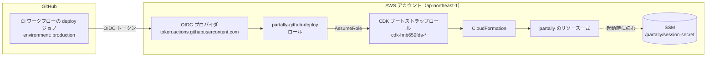

# 初期設定・デプロイ手順

partally を AWS にデプロイするまでの手順。デプロイ方法は 2 通りある。

| 方法 | 向いている場面 |
|---|---|
| [A. GitHub Actions からデプロイ](#a-github-actions-からデプロイ推奨) | 推奨。AWS のアクセスキーを手元にも GitHub にも置かない |
| [B. 手元の PC からデプロイ](#b-手元の-pc-からデプロイ) | AWS CLI の認証情報を手元に持っている場合 |

どちらも **AWS 側の共通準備（1〜3）** は同じ。

---

## 全体像



| AWS 側のもの | 作り方 | 役割 |
|---|---|---|
| セッション署名鍵（SSM） | 手順 2 で手動作成 | ログイン Cookie の改ざん検知（[後述](#セッション署名鍵とは)） |
| CDK ブートストラップ（`CDKToolkit` スタック） | 手順 3 | CDK がデプロイに使う S3 バケット・IAM ロール |
| OIDC プロバイダ | 手順 A-1（既存なら流用） | GitHub Actions が発行するトークンを AWS が信頼するための設定 |
| デプロイ用ロール（`partally-github-oidc` スタック） | 手順 A-1 | GitHub Actions が引き受けるロール |
| アプリ本体（`Partally` スタック） | デプロイ時に CDK が作成 | DynamoDB / Lambda / API Gateway / S3 / CloudFront など |
| CloudFront 署名用の秘密鍵（SSM `/partally/cloudfront-private-key`） | デプロイ時にカスタムリソースが自動作成 | 写真を見る権限（署名付き Cookie / URL）の発行。手動での作成は不要 |

---

## AWS 側の共通準備

以下はすべて AWS コンソールの **東京リージョン（ap-northeast-1）で CloudShell** を開いて実行できる（コンソール右上のターミナルアイコン）。手元に AWS CLI がある場合はそちらでもよい。

### 1. アカウントの確認

```sh
aws sts get-caller-identity --query Account --output text
```

デプロイしたいアカウント ID が表示されることを確認する。以降の例では `<ACCOUNT_ID>` と書く。

### 2. セッション署名鍵の作成

```sh
aws ssm put-parameter --name /partally/session-secret --type SecureString \
  --value "$(openssl rand -base64 48)"
```

- `{"Version": 1, "Tier": "Standard"}` が返れば成功。
- `ParameterAlreadyExists` は作成済みという意味なので、そのままでよい。
- パラメータ名を変えたい場合は `infra/cdk.json` の `context.sessionSecretParam` も合わせて変える。

### 3. CDK のブートストラップ

まず、既にブートストラップ済みかを確認する。

```sh
aws cloudformation describe-stacks --stack-name CDKToolkit \
  --query "Stacks[0].[StackStatus, Outputs[?OutputKey=='BootstrapVersion'].OutputValue | [0]]" --output text 2>&1
```

| 結果 | 対応 |
|---|---|
| `Stack with id CDKToolkit does not exist` | 未実施。下のコマンドでブートストラップする |
| `CREATE_COMPLETE 30` / `UPDATE_COMPLETE 32` など | 実施済み。下の「既存のブートストラップの確認」へ |

```sh
npx -y aws-cdk@2 bootstrap aws://<ACCOUNT_ID>/ap-northeast-1
```

#### 既存のブートストラップの確認

他のチームが既にブートストラップしている場合、設定が今回の構成と合うかを確認する。

```sh
aws cloudformation describe-stacks --stack-name CDKToolkit \
  --query "Stacks[0].Parameters[?ParameterKey=='Qualifier' || ParameterKey=='CloudFormationExecutionPolicies'].[ParameterKey,ParameterValue]" --output text
```

| 項目 | 期待値 | 違う場合 |
|---|---|---|
| `Qualifier` | `hnb659fds`（既定値） | `infra/github-oidc.yaml` のロール権限（`cdk-hnb659fds-*`）と CDK 側の設定を合わせる必要がある |
| `CloudFormationExecutionPolicies` | 空欄、または `AdministratorAccess` | 権限が絞られていると、リソース作成で失敗することがある |

空欄の場合は既定で `AdministratorAccess` が付く。実際に付いている権限は次で確認できる。

```sh
aws iam list-attached-role-policies \
  --role-name cdk-hnb659fds-cfn-exec-role-<ACCOUNT_ID>-ap-northeast-1 \
  --query "AttachedPolicies[].PolicyArn" --output text
```

---

## A. GitHub Actions からデプロイ（推奨）

### A-1. デプロイ用 IAM ロールの作成（AWS 側）

GitHub Actions の OIDC プロバイダはアカウントに 1 つしか作れない。既にあるかを確認する。

```sh
aws iam list-open-id-connect-providers --query "OpenIDConnectProviderList[].Arn" --output text \
  | tr '\t' '\n' | grep token.actions.githubusercontent.com
```

- **何も表示されない** → 未作成。下のコマンドで `CreateOidcProvider=true` のまま作成する。
- **ARN が表示される** → 既存のものを流用する（`CreateOidcProvider=false`）。その場合、Audience に `sts.amazonaws.com` が含まれることを確認する。

  ```sh
  aws iam get-open-id-connect-provider \
    --open-id-connect-provider-arn arn:aws:iam::<ACCOUNT_ID>:oidc-provider/token.actions.githubusercontent.com \
    --query ClientIDList
  ```

  既存のプロバイダを流用しても、プロバイダ自体は変更しないので他のシステムに影響はない。

ロールを作成する（OIDC プロバイダの有無と GitHub の数値 ID を自動で取得する版）。

```sh
curl -fsSLO https://raw.githubusercontent.com/ot-nemoto/partally/develop/infra/github-oidc.yaml

if aws iam list-open-id-connect-providers --output text | grep -q token.actions.githubusercontent.com; then
  CREATE=false
else
  CREATE=true
fi

# GitHub の owner とリポジトリの数値 ID（公開情報）
read OWNER_ID REPO_ID < <(curl -fsSL https://api.github.com/repos/ot-nemoto/partally \
  | python3 -c 'import json,sys; r=json.load(sys.stdin); print(r["owner"]["id"], r["id"])')
echo "CreateOidcProvider=$CREATE OwnerId=$OWNER_ID RepoId=$REPO_ID"

aws cloudformation deploy --stack-name partally-github-oidc \
  --template-file github-oidc.yaml --capabilities CAPABILITY_NAMED_IAM \
  --parameter-overrides CreateOidcProvider=$CREATE GitHubOwnerId=$OWNER_ID GitHubRepoId=$REPO_ID

aws cloudformation describe-stacks --stack-name partally-github-oidc \
  --query "Stacks[0].Outputs[?OutputKey=='DeployRoleArn'].OutputValue" --output text
```

最後に表示される `arn:aws:iam::<ACCOUNT_ID>:role/partally-github-deploy` を控える。

#### このロールの権限

- 引き受けられるのは **`ot-nemoto/partally` リポジトリの `production` Environment で動くジョブだけ**（`sub` クレームで制限）。
- GitHub の OIDC トークンの `sub` は、ユーザ名・リポジトリ名に数値 ID が付いた形式（`repo:ot-nemoto@<owner ID>/partally@<repo ID>:environment:production`）で発行される。ID を条件に含めることで、リポジトリやアカウントが削除され同じ名前で作り直された場合のなりすましも防ぐ。
- `GitHubOwnerId` / `GitHubRepoId` を省略すると、ID なしの形式（`repo:ot-nemoto/partally:environment:production`）で照合する。ロールの引き受けに失敗してトークンの形式を確かめたいときは、一時的に CI ワークフローの deploy ジョブへトークンのクレーム（`sub` など）を表示するステップを足す（以前の `deploy.yml` の「Show OIDC claims」ステップを git の履歴から戻せる）。
- ロール自体の権限は、CDK のブートストラップロール（`cdk-hnb659fds-*`）を引き受けることと、本番データの初期化 Lambda（`partally-reset`）を呼ぶことだけ。実際のリソース作成は、ブートストラップで作られた CloudFormation 実行ロールが行う。

### A-2. GitHub の Environment 設定

https://github.com/ot-nemoto/partally/settings/environments → **New environment** で `production` を作り、以下を登録する。

| 種類 | 名前 | 値 |
|---|---|---|
| Environment secrets | `PARTALLY_ADMIN_PASSWORD` | 管理者パスワード |
| Environment secrets | `AWS_ROLE_ARN` | A-1 で控えたロール ARN（必ず Secret にする。Variables だとステップの見出しに ARN がそのまま出て、公開リポジトリの Actions ログにアカウント ID が残る。未登録ならワークフローは最初に止まる） |
| Environment secrets | `PARTALLY_BUDGET_EMAIL` | 任意: 予算アラートの通知先（公開リポジトリの Actions ログに出ないよう Secret にする） |
| Environment variables | `PARTALLY_BUDGET_USD` | 任意: 予算（USD、既定 5） |

- Repository secrets（Settings → Secrets and variables → Actions）に登録しても動くが、Environment に登録すると **デプロイジョブ以外から参照できなくなる** ので、こちらを推奨する。
- **Deployment branches and tags** を「Selected branches and tags」にして `develop` だけを許可する。develop 以外のブランチに置いたワークフローからは `production` に入れず、ロールも引き受けられなくなる（develop への反映には PR のマージが必要になる）。
- 「Required reviewers」に自分を入れると、デプロイ前に承認が必要になる。
- ログに出るアカウント ID は、ロール ARN を Secret にすることと、ワークフローの `mask-aws-account-id` で `***` に伏せる。S3 バケット名・DynamoDB テーブル名・CloudFront の URL はログに出るが、それだけではアクセスできない（バケットは非公開、テーブルは IAM の権限が必要）。

### A-3. デプロイの実行

develop へ PR をマージする（develop へ push される）と、CI ワークフロー（`.github/workflows/ci.yml`）が lint・型チェック・テスト・ビルドの後に、deploy ジョブで本番へデプロイする。テストが失敗したらデプロイしない。

初回や、コードを変えずにデプロイし直したいときは、https://github.com/ot-nemoto/partally/actions/workflows/ci.yml → **Run workflow**（ブランチは `develop`）で手動実行する。

deploy ジョブは「インストール → 画面ビルド → CDK デプロイ」を行う。デプロイは 1 つずつ行い、続けて push されたときは最新のコミットだけをデプロイする（develop の先頭でなくなったコミットは省略する。新しいコミットが古い変更も含むため）。初回は CloudFront の作成があるため 10 分前後かかる。完了後、deploy ジョブの `Deploy` ステップのログ末尾に URL が出る。

```
Partally.Url = https://xxxxxxxx.cloudfront.net
Partally.AdminUrl = https://xxxxxxxx.cloudfront.net/admin
```

### A-4. リリース（develop → master）の設定

master にはリリースした版を置く。次のワークフローで自動化している。

| ワークフロー | 動くとき | すること |
|---|---|---|
| `auto-pr-to-master.yml` | 毎朝 6 時（JST）と手動実行 | develop に master にないコミットがあれば develop → master の PR を作る（あれば本文を更新）。含まれる Issue に `enhancement` ラベルがあれば `bump:minor`、なければ `bump:patch` のラベルを付ける |
| `bump-version.yml` | master 宛ての PR に `bump:*` ラベルが付いたとき | ルートの `package.json` のバージョンを上げて、PR のブランチ（develop）に push する（`GITHUB_TOKEN` での push のため CI・デプロイは動かない） |
| `release.yml` | master への push（PR のマージ） | `package.json` のバージョンで `v<バージョン>` のタグと GitHub Release を作る（同じタグがあれば何もしない） |

master へのマージはデプロイしない（本番には develop へのマージで反映済み）。

develop → master の PR は **「Create a merge commit」でマージする**。Squash や Rebase でマージすると develop のコミットが master に入らず、翌日以降も同じコミットが差分として残り、毎回過去の変更を含む PR が作られる。

使うには、PR を作るための個人アクセストークンを登録する（`GITHUB_TOKEN` で作った PR やラベルではほかのワークフローが動かず、`bump-version.yml` が動かないため）。

1. https://github.com/settings/personal-access-tokens/new で Fine-grained token を作る。
   - **Repository access**: Only select repositories → `ot-nemoto/partally`
   - **Permissions**: Pull requests（Read and write）、Issues（Read and write）、Contents（Read-only）
   - 有効期限が切れたら作り直して登録し直す
2. https://github.com/ot-nemoto/partally/settings/secrets/actions → **New repository secret** で `AUTO_PR_TOKEN` に登録する（Environment ではなく Repository secrets。production に入れると、develop 以外で動くこのワークフローから読めない）。

`bump-version.yml` は `GITHUB_TOKEN` で develop に push する。develop にブランチ保護（直接 push の禁止など）を設定する場合は、`github-actions[bot]` の push を許可しないとバージョンを上げられない。

依存パッケージ（npm）と Actions の更新は、Dependabot（`.github/dependabot.yml`）が毎週月曜に develop 宛ての PR を作る。CI が通ったものをマージすると、ほかの PR と同じくデプロイされる。

---

## B. 手元の PC からデプロイ

AWS 側の共通準備（1〜3）を済ませた上で、Node.js 22・npm 11 以上・AWS CLI の認証情報がある環境で実行する。

```sh
git clone https://github.com/ot-nemoto/partally.git
cd partally
npx npm@11 install

export AWS_REGION=ap-northeast-1
export PARTALLY_ADMIN_PASSWORD='管理者パスワード'
export PARTALLY_BUDGET_EMAIL='alert@example.com'   # 任意
export PARTALLY_BUDGET_USD=5                        # 任意
npm run deploy
```

AWS CLI のプロファイルに別リージョンが設定されていると、そちらにデプロイされる。`AWS_REGION` を必ず指定する。

---

## デプロイ後

### 動作確認

1. `AdminUrl` を開き、管理者パスワードでログインする。
2. 「QR」で数件発行し、「未使用分を印刷」を開く。
3. 画面上の QR をスマホのカメラで読み込み、名前を登録する。
4. 管理画面の「User」に二つ名付きで表示されることを確認する。

QR にはそのページを開いたドメインの URL が入る。**本番の管理画面から印刷すること**（ローカル開発環境で印刷した QR は使えない）。イベントの準備から当日の進め方は [幹事向けガイド](organizer-guide.md) を参照。

### 予算アラートを有効にする

予算（`PARTALLY_BUDGET_EMAIL` を指定した場合に作成）は `Project=partally` タグで費用を絞り込んでいる。タグで集計するには、`Project` を **コスト配分タグ** として有効化する必要がある。**有効化するまでは費用 0 として集計されるため、アラートは届かない。**

- 有効化は無料。
- 有効化できるのは、請求データにタグが出てきてから。タグ付きのリソースに費用が発生してから最大 24 時間かかり、費用がほぼゼロのリソースばかりだと数日かかることもある。**デプロイの翌日以降に行う。**
- AWS Organizations 配下のアカウントでは、有効化できるのは **管理（支払い）アカウント** だけ。管理アカウントの担当者に依頼する。
- 有効化するのは `Project` だけでよい。一覧に出る `aws:cloudformation:*` や `aws-cdk:*`、他のシステムのタグは触らなくてよい。

#### CLI（CloudShell）で行う場合

Cost Explorer の API は `us-east-1` で提供されているため、`--region us-east-1` を付ける。

```sh
# 請求データにタグが出ているか確認する
aws ce list-cost-allocation-tags --region us-east-1 --tag-keys Project \
  --query "CostAllocationTags[].[TagKey,Status]" --output text
```

| 結果 | 意味 |
|---|---|
| 何も表示されない | まだ反映待ち。翌日以降にもう一度確認する |
| `Project  Inactive` | 有効化できる |
| `Project  Active` | 有効化済み |

```sh
# 有効化する
aws ce update-cost-allocation-tags-status --region us-east-1 \
  --cost-allocation-tags-status TagKey=Project,Status=Active
```

成功すると `{"Errors": []}` が返る。タグがまだ反映されていない場合は `Errors` にエラーが入るので、翌日以降に再実行する。

#### コンソールで行う場合

請求とコスト管理 → **コスト配分タグ** → 検索欄に `Project` と入力 → チェックを入れて **有効化**。ステータスが「アクティブ」になれば完了。一覧に無い場合はまだ反映待ち。画面上部の「タグのバックフィル」（過去の費用への遡り）は不要。

#### 予算アラートについての注意

- `PARTALLY_BUDGET_USD` は **上限ではなく通知の目安**。実績がその 80% を超えるとメールが届くが、リソースの停止や課金の制限はしない。
- この手順を CDK で自動化していないのは、請求データにタグが出る前は有効化できず、初回のデプロイでは必ず失敗するため（成功するのは後日の再デプロイになり、手作業で 1 回行うのと手間が変わらない）。また Organizations 配下では管理アカウントでしか実行できない。

---

## 環境変数

### デプロイ時（`npm run deploy` を実行するシェルで設定）

| 変数 | 必須 | 既定値 | 説明 |
|---|---|---|---|
| `PARTALLY_ADMIN_PASSWORD` | ○ | – | 管理画面のログインパスワード。Lambda の環境変数 `ADMIN_PASSWORD` として渡る。未設定だと synth/deploy がエラーで止まる |
| `PARTALLY_BUDGET_EMAIL` | – | – | 設定すると AWS Budgets の月額予算を作成し、このアドレスにアラートメールを送る。未設定なら予算は作らない |
| `PARTALLY_BUDGET_USD` | – | `5` | 月額予算の金額（USD）。実績がこの 80% を超えると通知する。`PARTALLY_BUDGET_EMAIL` 未設定時は無視される |
| `AWS_PROFILE` / `AWS_REGION` など | – | – | 通常の AWS CLI の認証・リージョン設定。CDK はここからデプロイ先アカウント・リージョンを決める（`CDK_DEFAULT_ACCOUNT` / `CDK_DEFAULT_REGION` として CDK CLI が自動で設定する）。リージョンが取れない場合は `ap-northeast-1` |

予算アラートは通知するだけで、リソースを止めたり課金を制限したりはしない。

SSM パラメータ名は環境変数ではなく `infra/cdk.json` の context で指定する。

| context | 既定値 | 説明 |
|---|---|---|
| `sessionSecretParam` | `/partally/session-secret` | セッション署名鍵（手順 2 で作成） |
| `cloudfrontPrivateKeyParam` | `/partally/cloudfront-private-key` | CloudFront 署名用の秘密鍵（デプロイ時に自動作成） |

### Lambda 実行時（CDK が自動で設定するため、手動での設定は不要）

API の Lambda には次のすべてを、写真の取り込み・初期化の Lambda には `TABLE_NAME`・`PHOTO_BUCKET`・`DISTRIBUTION_ID`・`NODE_OPTIONS` だけを設定する。

| 変数 | 説明 |
|---|---|
| `TABLE_NAME` | DynamoDB テーブル名 |
| `ADMIN_PASSWORD` | 管理者パスワード（`PARTALLY_ADMIN_PASSWORD` の値） |
| `SESSION_SECRET_PARAM` | セッション署名鍵の SSM パラメータ名。コールドスタート時に値を取得する |
| `PHOTO_BUCKET` | 写真・景品の画像を置く S3 バケット名 |
| `DISTRIBUTION_ID` | CloudFront ディストリビューション ID（キャッシュの無効化に使う） |
| `CLOUDFRONT_PRIVATE_KEY_PARAM` / `CLOUDFRONT_KEY_PAIR_ID` | 写真・景品の画像の署名付き Cookie / URL を作る鍵（SSM パラメータ名と公開鍵 ID） |
| `NODE_OPTIONS` | `--enable-source-maps`（エラーのスタックトレースを TypeScript の行番号で出す） |

### 注意

- 管理者パスワードは Lambda の環境変数（と CloudFormation テンプレート）に平文で入る。
- 予算アラートは `Project=partally` タグで絞り込む。タグでの絞り込みには、請求コンソールで `Project` をコスト配分タグとして有効化しておく必要がある。
- DynamoDB テーブルと写真バケットは誤削除防止のため、スタックを削除しても残る（`RETAIN`）。消し方は「[後片付け](#後片付け)」を参照。

---

## 本番データの初期化

リハーサルの後や次のイベントの前に、本番のデータをすべて消してデプロイ直後の状態に戻す。

- **消えるもの**: 参加者・QR（通し番号も 001 から）・写真（S3 のファイルも）・お気に入り・クイズと回答・景品（画像も）・設定（既定値に戻る）
- **残るもの**: セッション署名鍵・CloudFront の鍵（SSM）、インフラ自体、画面
- 元に戻せない。QR は印刷し直しになる。参加者は登録ごと消えるのでログインが切れる（管理画面のログインは残る）。
- 参加者が使っていないときに実行する。消している間に届いた写真や回答は、スキャンし直して消すが、使われ続けていると残ることがある。

### 準備（1 回だけ）

初期化はデプロイ用ロールから初期化 Lambda を呼んで行う。この機能より前に `partally-github-oidc` スタックを作った場合は、ロールに呼び出し権限を足すため、最新のテンプレートでスタックを更新する（パラメータは前回の値が引き継がれる）。

```sh
curl -fsSLO https://raw.githubusercontent.com/ot-nemoto/partally/develop/infra/github-oidc.yaml
aws cloudformation deploy --stack-name partally-github-oidc \
  --template-file github-oidc.yaml --capabilities CAPABILITY_NAMED_IAM
```

初期化 Lambda はデプロイで作られるので、この機能を含むバージョンを一度デプロイしておく。

### 実行

https://github.com/ot-nemoto/partally/actions/workflows/reset.yml → **Run workflow**（ブランチは `develop`）→ 確認欄に `初期化` と入力して実行する。

- 実行できるのは、リポジトリへの書き込み権限があり、`production` Environment に入れる人だけ（Environment のブランチ制限で `develop` からのみ）。誰がいつ実行したかは Actions の履歴に残る。
- 確認欄が `初期化` でなければ、何も消さずに止まる。
- 「Reset」ステップのログに、消したアイテム数と写真の数が出る（例: `結果: {"items":420,"objects":180}`）。
- 失敗したら、もう一度実行すれば残りを消せる（何度実行しても同じ結果になる）。エラーの詳細は公開ログには出さず、CloudWatch Logs の `ResetLogs` に残る。
- 初期化の後は、管理画面で QR を発行し直して印刷する。景品も登録し直す。

## セッション署名鍵とは

手順 2 で作る `/partally/session-secret` は、**ログイン Cookie が改ざん・偽造されていないかを確かめるための秘密の値**。

### 仕組み

QR でログインすると、API はブラウザに `session` Cookie を渡す。

```
<base64url({ uid: ユーザID, tok: QRトークン, iat: 発行時刻 })>.<署名>
```

- 署名は、中身を署名鍵で HMAC-SHA256 した値。
- API はリクエストのたびに同じ計算をして署名と照合し、一致しなければ未ログインとして扱う。
- 中身を書き換える（例: `uid` を他人の ID にする）と署名が合わなくなるため、署名鍵を知らない限りなりすましはできない。
- `tok` を含めているので、管理者が QR の紐づけを解除すると、そのユーザの古い Cookie は使えなくなる。

| Cookie | 用途 | 有効期限 |
|---|---|---|
| `session` | 参加者のログイン | 30 日 |
| `admin_session` | 管理者のログイン | 12 時間 |

### 扱い

- 値は SSM に暗号化して保存し、Lambda だけがコールドスタート時に読み取る。画面や GitHub には出ない。
- **署名鍵を変更すると全員のログインが切れる**（参加者は QR を読み直せば再ログインできる）。漏えいが疑われる場合は、値を変更してから再デプロイ（または Lambda の再起動）する。

  ```sh
  aws ssm put-parameter --name /partally/session-secret --type SecureString --overwrite \
    --value "$(openssl rand -base64 48)"
  ```

- 写真機能で使う「CloudFront 署名用の鍵」とは別物（写真機能の実装時に追加する）。

---

## 後片付け

```sh
# アプリ本体（CloudFormation コンソールで Partally スタックを削除してもよい）
aws cloudformation delete-stack --stack-name Partally

# GitHub Actions 用ロール
aws cloudformation delete-stack --stack-name partally-github-oidc

# 署名鍵
aws ssm delete-parameter --name /partally/session-secret
```

- DynamoDB テーブルと写真バケットは誤削除防止のため `Partally` スタックを消しても残る。不要ならコンソールから手動で削除する（バケットは中身を空にしてから）。
- CloudFront 署名用の秘密鍵（`/partally/cloudfront-private-key`）は `Partally` スタックの削除時に自動で消える。
- `partally-github-oidc` を `CreateOidcProvider=true` で作った場合、スタック削除で OIDC プロバイダも消える。他のシステムが後から使い始めていないか確認してから削除する。
- `CDKToolkit` スタックは他のシステムも使っている可能性があるため、消さない。
