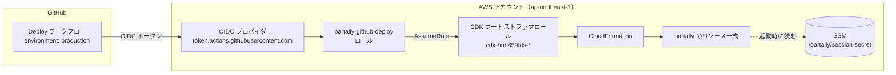

# 初期設定・デプロイ手順

partally を AWS にデプロイするまでの手順。デプロイ方法は 2 通りある。

| 方法 | 向いている場面 |
|---|---|
| [A. GitHub Actions からデプロイ](#a-github-actions-からデプロイ推奨) | 推奨。AWS のアクセスキーを手元にも GitHub にも置かない |
| [B. 手元の PC からデプロイ](#b-手元の-pc-からデプロイ) | AWS CLI の認証情報を手元に持っている場合 |

どちらも **AWS 側の共通準備（1〜3）** は同じ。

---

## 全体像



| AWS 側のもの | 作り方 | 役割 |
|---|---|---|
| セッション署名鍵（SSM） | 手順 2 で手動作成 | ログイン Cookie の改ざん検知（[後述](#セッション署名鍵とは)） |
| CDK ブートストラップ（`CDKToolkit` スタック） | 手順 3 | CDK がデプロイに使う S3 バケット・IAM ロール |
| OIDC プロバイダ | 手順 A-1（既存なら流用） | GitHub Actions が発行するトークンを AWS が信頼するための設定 |
| デプロイ用ロール（`partally-github-oidc` スタック） | 手順 A-1 | GitHub Actions が引き受けるロール |
| アプリ本体（`Partally` スタック） | デプロイ時に CDK が作成 | DynamoDB / Lambda / API Gateway / S3 / CloudFront など |

---

## AWS 側の共通準備

以下はすべて AWS コンソールの **東京リージョン（ap-northeast-1）で CloudShell** を開いて実行できる（コンソール右上のターミナルアイコン）。手元に AWS CLI がある場合はそちらでもよい。

### 1. アカウントの確認

```sh
aws sts get-caller-identity --query Account --output text
```

デプロイしたいアカウント ID が表示されることを確認する。以降の例では `<ACCOUNT_ID>` と書く。

### 2. セッション署名鍵の作成

```sh
aws ssm put-parameter --name /partally/session-secret --type SecureString \
  --value "$(openssl rand -base64 48)"
```

- `{"Version": 1, "Tier": "Standard"}` が返れば成功。
- `ParameterAlreadyExists` は作成済みという意味なので、そのままでよい。
- パラメータ名を変えたい場合は `infra/cdk.json` の `context.sessionSecretParam` も合わせて変える。

### 3. CDK のブートストラップ

まず、既にブートストラップ済みかを確認する。

```sh
aws cloudformation describe-stacks --stack-name CDKToolkit \
  --query "Stacks[0].[StackStatus, Outputs[?OutputKey=='BootstrapVersion'].OutputValue | [0]]" --output text 2>&1
```

| 結果 | 対応 |
|---|---|
| `Stack with id CDKToolkit does not exist` | 未実施。下のコマンドでブートストラップする |
| `CREATE_COMPLETE 30` / `UPDATE_COMPLETE 32` など | 実施済み。下の「既存のブートストラップの確認」へ |

```sh
npx -y aws-cdk@2 bootstrap aws://<ACCOUNT_ID>/ap-northeast-1
```

#### 既存のブートストラップの確認

他のチームが既にブートストラップしている場合、設定が今回の構成と合うかを確認する。

```sh
aws cloudformation describe-stacks --stack-name CDKToolkit \
  --query "Stacks[0].Parameters[?ParameterKey=='Qualifier' || ParameterKey=='CloudFormationExecutionPolicies'].[ParameterKey,ParameterValue]" --output text
```

| 項目 | 期待値 | 違う場合 |
|---|---|---|
| `Qualifier` | `hnb659fds`（既定値） | `infra/github-oidc.yaml` のロール権限（`cdk-hnb659fds-*`）と CDK 側の設定を合わせる必要がある |
| `CloudFormationExecutionPolicies` | 空欄、または `AdministratorAccess` | 権限が絞られていると、リソース作成で失敗することがある |

空欄の場合は既定で `AdministratorAccess` が付く。実際に付いている権限は次で確認できる。

```sh
aws iam list-attached-role-policies \
  --role-name cdk-hnb659fds-cfn-exec-role-<ACCOUNT_ID>-ap-northeast-1 \
  --query "AttachedPolicies[].PolicyArn" --output text
```

---

## A. GitHub Actions からデプロイ（推奨）

### A-1. デプロイ用 IAM ロールの作成（AWS 側）

GitHub Actions の OIDC プロバイダはアカウントに 1 つしか作れない。既にあるかを確認する。

```sh
aws iam list-open-id-connect-providers --query "OpenIDConnectProviderList[].Arn" --output text \
  | tr '\t' '\n' | grep token.actions.githubusercontent.com
```

- **何も表示されない** → 未作成。下のコマンドで `CreateOidcProvider=true` のまま作成する。
- **ARN が表示される** → 既存のものを流用する（`CreateOidcProvider=false`）。その場合、Audience に `sts.amazonaws.com` が含まれることを確認する。

  ```sh
  aws iam get-open-id-connect-provider \
    --open-id-connect-provider-arn arn:aws:iam::<ACCOUNT_ID>:oidc-provider/token.actions.githubusercontent.com \
    --query ClientIDList
  ```

  既存のプロバイダを流用しても、プロバイダ自体は変更しないので他のシステムに影響はない。

ロールを作成する（OIDC プロバイダの有無と GitHub の数値 ID を自動で取得する版）。

```sh
curl -fsSLO https://raw.githubusercontent.com/ot-nemoto/partally/claude/friendly-shannon-yppq56/infra/github-oidc.yaml

if aws iam list-open-id-connect-providers --output text | grep -q token.actions.githubusercontent.com; then
  CREATE=false
else
  CREATE=true
fi

# GitHub の owner とリポジトリの数値 ID（公開情報）
read OWNER_ID REPO_ID < <(curl -fsSL https://api.github.com/repos/ot-nemoto/partally \
  | python3 -c 'import json,sys; r=json.load(sys.stdin); print(r["owner"]["id"], r["id"])')
echo "CreateOidcProvider=$CREATE OwnerId=$OWNER_ID RepoId=$REPO_ID"

aws cloudformation deploy --stack-name partally-github-oidc \
  --template-file github-oidc.yaml --capabilities CAPABILITY_NAMED_IAM \
  --parameter-overrides CreateOidcProvider=$CREATE GitHubOwnerId=$OWNER_ID GitHubRepoId=$REPO_ID

aws cloudformation describe-stacks --stack-name partally-github-oidc \
  --query "Stacks[0].Outputs[?OutputKey=='DeployRoleArn'].OutputValue" --output text
```

最後に表示される `arn:aws:iam::<ACCOUNT_ID>:role/partally-github-deploy` を控える。

#### このロールの権限

- 引き受けられるのは **`ot-nemoto/partally` リポジトリの `production` Environment で動くジョブだけ**（`sub` クレームで制限）。
- GitHub の OIDC トークンの `sub` は、ユーザ名・リポジトリ名に数値 ID が付いた形式（`repo:ot-nemoto@<owner ID>/partally@<repo ID>:environment:production`）で発行される。ID を条件に含めることで、リポジトリやアカウントが削除され同じ名前で作り直された場合のなりすましも防ぐ。
- `GitHubOwnerId` / `GitHubRepoId` を省略すると、ID なしの形式（`repo:ot-nemoto/partally:environment:production`）で照合する。トークンがどちらの形式かは、Deploy ワークフローの「Show OIDC claims」ステップのログで確認できる。
- ロール自体の権限は CDK のブートストラップロール（`cdk-hnb659fds-*`）を引き受けることだけ。実際のリソース作成は、ブートストラップで作られた CloudFormation 実行ロールが行う。

### A-2. GitHub の Environment 設定

https://github.com/ot-nemoto/partally/settings/environments → **New environment** で `production` を作り、以下を登録する。

| 種類 | 名前 | 値 |
|---|---|---|
| Environment secrets | `PARTALLY_ADMIN_PASSWORD` | 管理者パスワード |
| Environment variables | `AWS_ROLE_ARN` | A-1 で控えたロール ARN |
| Environment variables | `PARTALLY_BUDGET_EMAIL` | 任意: 予算アラートの通知先 |
| Environment variables | `PARTALLY_BUDGET_USD` | 任意: 予算（USD、既定 5） |

- Repository secrets（Settings → Secrets and variables → Actions）に登録しても動くが、Environment に登録すると **デプロイジョブ以外から参照できなくなる** ので、こちらを推奨する。
- 「Required reviewers」に自分を入れると、デプロイ前に承認が必要になる。

### A-3. デプロイの実行

https://github.com/ot-nemoto/partally/actions/workflows/deploy.yml → **Run workflow**。

ワークフローは「インストール → 型チェック・テスト → 画面ビルド → CDK デプロイ」を行う。初回は CloudFront の作成があるため 10 分前後かかる。完了後、`Deploy` ステップのログ末尾に URL が出る。

```
Partally.Url = https://xxxxxxxx.cloudfront.net
Partally.AdminUrl = https://xxxxxxxx.cloudfront.net/admin
```

---

## B. 手元の PC からデプロイ

AWS 側の共通準備（1〜3）を済ませた上で、Node.js 22・npm 11 以上・AWS CLI の認証情報がある環境で実行する。

```sh
git clone https://github.com/ot-nemoto/partally.git
cd partally
npx npm@11 install

export AWS_REGION=ap-northeast-1
export PARTALLY_ADMIN_PASSWORD='管理者パスワード'
export PARTALLY_BUDGET_EMAIL='alert@example.com'   # 任意
export PARTALLY_BUDGET_USD=5                        # 任意
npm run deploy
```

AWS CLI のプロファイルに別リージョンが設定されていると、そちらにデプロイされる。`AWS_REGION` を必ず指定する。

---

## デプロイ後

### 動作確認

1. `AdminUrl` を開き、管理者パスワードでログインする。
2. 「QR」で数件発行し、「未使用分を印刷」を開く。
3. 画面上の QR をスマホのカメラで読み込み、名前を登録する。
4. 管理画面の「ユーザ」に二つ名付きで表示されることを確認する。

QR にはそのページを開いたドメインの URL が入る。**本番の管理画面から印刷すること**（ローカル開発環境で印刷した QR は使えない）。

### 予算アラートを有効にする

予算は `Project=partally` タグで絞り込んでいる。タグで集計するには、請求コンソールの **コスト配分タグ** で `Project` を有効化する必要がある。

- タグが一覧に出るのは、リソース作成から最大 24 時間後。デプロイの翌日以降に有効化する。
- 有効化するまでは費用 0 として集計されるため、アラートは届かない。
- アラートは通知のみで、リソースの停止や課金の制限はしない。

---

## セッション署名鍵とは

手順 2 で作る `/partally/session-secret` は、**ログイン Cookie が改ざん・偽造されていないかを確かめるための秘密の値**。

### 仕組み

QR でログインすると、API はブラウザに `session` Cookie を渡す。

```
<base64url({ uid: ユーザID, tok: QRトークン, iat: 発行時刻 })>.<署名>
```

- 署名は、中身を署名鍵で HMAC-SHA256 した値。
- API はリクエストのたびに同じ計算をして署名と照合し、一致しなければ未ログインとして扱う。
- 中身を書き換える（例: `uid` を他人の ID にする）と署名が合わなくなるため、署名鍵を知らない限りなりすましはできない。
- `tok` を含めているので、管理者が QR の紐づけを解除すると、そのユーザの古い Cookie は使えなくなる。

| Cookie | 用途 | 有効期限 |
|---|---|---|
| `session` | 参加者のログイン | 30 日 |
| `admin_session` | 管理者のログイン | 12 時間 |

### 扱い

- 値は SSM に暗号化して保存し、Lambda だけがコールドスタート時に読み取る。画面や GitHub には出ない。
- **署名鍵を変更すると全員のログインが切れる**（参加者は QR を読み直せば再ログインできる）。漏えいが疑われる場合は、値を変更してから再デプロイ（または Lambda の再起動）する。

  ```sh
  aws ssm put-parameter --name /partally/session-secret --type SecureString --overwrite \
    --value "$(openssl rand -base64 48)"
  ```

- 写真機能で使う「CloudFront 署名用の鍵」とは別物（写真機能の実装時に追加する）。

---

## 後片付け

```sh
# アプリ本体（CloudFormation コンソールで Partally スタックを削除してもよい）
aws cloudformation delete-stack --stack-name Partally

# GitHub Actions 用ロール
aws cloudformation delete-stack --stack-name partally-github-oidc

# 署名鍵
aws ssm delete-parameter --name /partally/session-secret
```

- DynamoDB テーブルは誤削除防止のため `Partally` スタックを消しても残る。不要ならコンソールから手動で削除する。
- `partally-github-oidc` を `CreateOidcProvider=true` で作った場合、スタック削除で OIDC プロバイダも消える。他のシステムが後から使い始めていないか確認してから削除する。
- `CDKToolkit` スタックは他のシステムも使っている可能性があるため、消さない。
